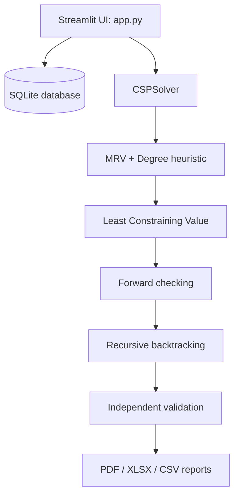

# SmartAlloc — Intelligent Room Allocation System

SmartAlloc is a local-first Streamlit application for examination room allocation. It includes student and room management, configurable seat layouts, a genuine CSP solver, independent validation, seating charts, SQLite persistence, and PDF/Excel/CSV exports.

## Features
- Student records, search, CSV/Excel import, CSV template.
- Room creation and seat-level accessible, blocked, and aisle configuration.
- CSP allocation using recursive backtracking, forward checking, MRV, degree tie-breaking and LCV.
- Hard constraints for unique seats, room availability, accessibility/facilities and same-group adjacency.
- Independent post-solve validation; failed results are never presented as successful.
- SQLite persistence and backup, dashboard analytics, seating charts and downloadable reports.
- One-click demo dataset (100 students, 5 rooms).

## Technology
Python 3.11+, Streamlit, Pandas, Plotly, SQLite, ReportLab, OpenPyXL, Pytest.

## Architecture



## CSP algorithm
- **Variables:** one variable per selected student.
- **Domains:** available, unblocked seats in selected available rooms that satisfy accessibility and room-facility needs.
- **Hard constraints:** no duplicate seat; same-group students cannot occupy neighboring seats within the configured Manhattan-distance threshold; accessibility and room facility requirements must be met.
- **Search:** MRV selects the variable with the smallest current domain. Degree breaks ties using same-group constraint degree. LCV orders seats by estimated domain impact. Forward checking removes occupied and conflicting seats from remaining domains. Recursive backtracking explores alternatives when a domain becomes empty.
- **Optimization:** accessible students are prioritized in MRV tie-breaking; optional room balancing prefers less-used rooms. Preferences never override hard constraints.

## Installation

```bash
python -m venv .venv
# Windows: .venv\Scripts\activate
# macOS/Linux: source .venv/bin/activate
pip install -r requirements.txt
```

## Run

```bash
streamlit run app.py
```

The database `smartalloc.db` is created automatically in the working directory. Use **Load demonstration data** in the sidebar for a ready-to-run sample.

## Import format
CSV/XLSX student import expects columns `student_id`, `name`, `roll_number`, and `group`. Optional column: `department`. A sample is in `data/sample_students.csv`.

## Tests

```bash
pytest -v
```

## Example use cases
1. Load demonstration data and generate an end-semester seating allocation.
2. Mark seats blocked or accessible in Seat Configuration and regenerate.
3. Import a student roster and configure room facilities.
4. Export the validated result as PDF, Excel, or CSV.
5. Reduce accessible capacity or total capacity to inspect pre-search and solver diagnostics.

## Screenshots
Add screenshots of the Overview Dashboard, Student Management, Room Management, Seating Charts and Reports here after running the application.

## Data and privacy
Records are stored locally in SQLite. No network service or cloud database is required. Back up `smartalloc.db` before moving or reinstalling the application. Do not load real student personal data into a public repository.

## Limitations
- The application is a practical academic/admin prototype, not a certified examination-management system.
- Adjacency is modeled on a rectangular grid using Manhattan distance; aisle seats interrupt adjacency.
- Conflict diagnosis reports detected causes and useful suggestions, not a proof that a single reported factor is the only cause.
- Restore is performed by replacing the local SQLite database with a trusted backup while the app is stopped.

## License
MIT License. See `LICENSE`.
